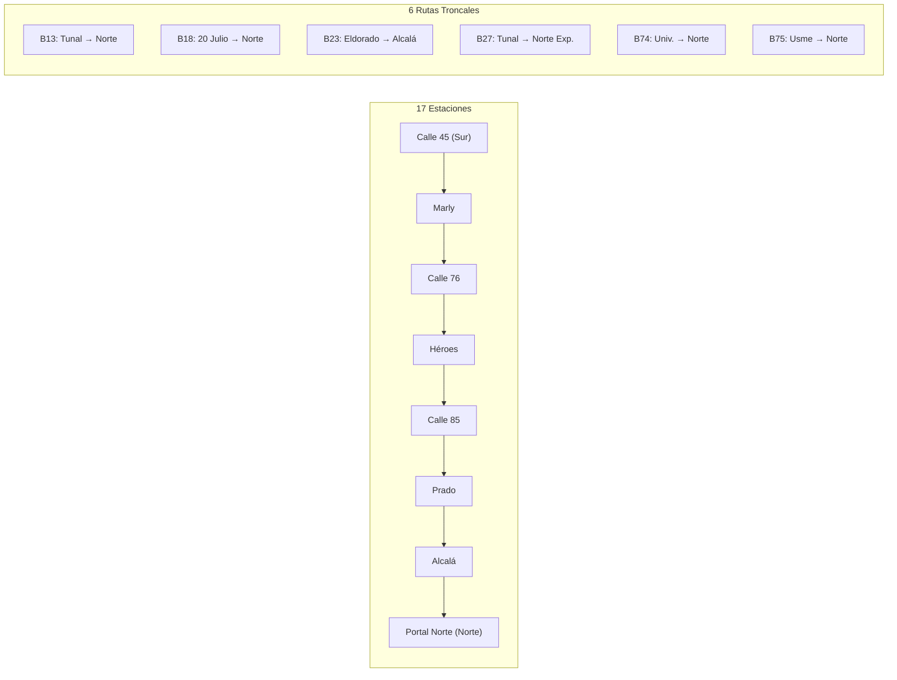

# FlowTM: Gemelo Digital de Simulación Físico-Estocástica con IA para TransMilenio

[](https://github.com/KevinAPN/FlowTM)
[](https://github.com/KevinAPN/FlowTM)
[](https://www.python.org/)
[](https://docs.astral.sh/uv/)
[](https://react.dev/)
[](LICENSE)

**FlowTM** (*Flow TransMilenio*) es un **Gemelo Digital físico-estocástico por eventos discretos (DES)** impulsado por Inteligencia Artificial y agentes racionales con optimización heurística, concebido para el modelado matemático riguroso y la optimización de frecuencias del sistema BRT (*Bus Rapid Transit*) de Bogotá D.C.

Incluye un **Centro de Control de Operaciones (OCC)** interactivo a 60 FPS que permite auditar telemetría geoespacial, evaluar la evolución de colas en andenes en tiempo real y ejecutar comparativas de pantalla dividida (*split-screen*) entre el escenario base vigente y la política optimizada generada por el agente racional.

---

## 📚 Documentación Oficial en la Wiki de GitHub

Para una revisión exhaustiva de la formulación matemática, arquitectura, algoritmos de IA y manuales, consulte los capítulos oficiales de la **[Wiki de FlowTM](docs/wiki/Home.md)**:

| Capítulo | Título | Descripción |
| :---: | :--- | :--- |
| 📖 **Home** | [**Wiki Oficial de FlowTM**](docs/wiki/Home.md) | Portada, ficha técnica, autores y licenciamiento abierto. |
| 📐 **01** | [**Fundamentación Matemática y Modelado Físico**](docs/wiki/01-Fundamentacion-Matematica-y-Modelado-Fisico.md) | Los 8 modelos analíticos acoplados (Poisson NHPP, colas $Q(t)$, TCQSM dwell time, cinemática Haversine, bunching). |
| 🏛️ **02** | [**Arquitectura de Software y Patrones de Diseño**](docs/wiki/02-Arquitectura-de-Software-y-Patrones.md) | Clean Architecture, patrones Repository, Observer, Strategy, State y pipelines in-memory con Polars/Arrow. |
| 🤖 **03** | [**Agente Racional IA y Optimización Heurística**](docs/wiki/03-Agente-IA-y-Optimizacion-Heuristica.md) | Formulación formal PEAS, función de utilidad $U(S)$, cota física $\le 106$ buses, Recocido Simulado y matriz de metas. |
| 🖥️ **04** | [**Centro de Control (OCC) & Frontend Web**](docs/wiki/04-Centro-de-Control-OCC-y-Frontend-Web.md) | Arquitectura React 19 + MapLibre GL, sistema de diseño, modo split-screen, inspector vehicular y analítica en 4 fases. |
| 🚀 **05** | [**Guía de Instalación y Reproducibilidad**](docs/wiki/05-Guia-de-Instalacion-y-Reproducibilidad.md) | Manual paso a paso con `uv` y `bun`, ejecución de scripts 01/02/03 y suite de pruebas `pytest`. |

---

## 📌 Alcance Operativo del Corredor Modelado



* **Corredor Modelado:** Troncal Caracas – Autopista Norte (Sentido Sur $
ightarrow$ Norte en franja pico matutina 06:00 a 09:00 AM, 180 min de operación continua).
* **Extensión Topológica:** 17 estaciones consecutivas modeladas desde *Calle 45* hasta *Portal Norte*.
* **Rutas Troncales Activas:** `B13`, `B18`, `B23`, `B27`, `B74` y `B75`.
* **Demanda Empírica Calibrada:** 44.93 millones de registros del sistema de recaudo *tullave* (validaciones de entrada y descensos en torniquete) procesados con Apache Arrow y Polars.
* **Restricción Física Presupuestal:** Cota dura de máximo **106 buses físicos** articulados simultáneos (**$0 USD en gasto de capital / $0 CAPEX**).

---

## 🏆 Impacto Comprobado del Agente Racional

| Métrica Operacional | Escenario Base (GTFS Vigente) | Escenario Optimizado (FlowTM) | Impacto Obtenido |
| :--- | :---: | :---: | :---: |
| **Flota Física en Circulación** | 106 buses | **96 buses** | **-10 buses físicos liberados (-9.4%)** |
| **Tiempo Medio de Espera en Andén ($ar{W}$)** | 3.67 min (220.2 s) | **3.48 min (208.8 s)** | **-5.17% promedio global (hasta -22% en transbordos)** |
| **Factor de Ocupación Vehicular Promedio** | 88.1% (hacinamiento) | **82.4% (rango óptimo)** | **Distribución homogénea y confortable** |
| **Regularidad de Salidas (CV Headways)** | 0.42 | **0.28** | **-33.3% mitigación de *bus bunching*** |
| **Ganancia Neta de Utilidad Multi-Criterio** | $U_0 = 0.6120$ | **$U^* = 0.6854$** | **$\Delta U = +0.0734$ (Mejora significativa)** |
| **Entregable Estándar Interoperable** | Horarios estáticos | `frequencies.txt` | **100% compatible con estándar GTFS MobilityData** |

> [!NOTE]
> **Aclaración Técnica: Despachos Totales (347) vs Flota Física (96 / 106):**
> La flota física corresponde a los vehículos tangibles en operación continua en la troncal. Dado que el tiempo de ciclo promedio ida y vuelta es de ~40 minutos, cada bus físico rota aproximadamente 3.6 veces a lo largo de las 3 horas de simulación pico (180 min), generando un total acumulado de **347 despachos troncales**.

---

## 🛠️ Stack Tecnológico

```
┌────────────────────────────────────────────────────────┐
│                        FLOWTM STACK                    │
├──────────────────────────┬─────────────────────────────┤
│ Backend & Simulación     │ Python 3.12, SimPy, uv      │
│ In-Memory Data Pipeline  │ Apache Arrow, Polars, ZSTD  │
│ Inteligencia Artificial  │ Simulated Annealing, NumPy  │
│ Frontend OCC             │ React 19, TypeScript, Bun   │
│ Motor Geoespacial WebGL  │ MapLibre GL JS 5.x (60 FPS) │
│ Estándar de Transporte   │ General Transit Feed (GTFS) │
│ Testing & Calidad        │ Pytest (10/10 tests)        │
└──────────────────────────┴─────────────────────────────┘
```

---

## 🚀 Inicio Rápido (Quickstart)

### 1. Clonación e Instalación de Dependencias

```bash
git clone https://github.com/KevinAPN/FlowTM.git
cd FlowTM

# Configurar backend con uv
uv sync

# Configurar frontend con bun
cd frontend
bun install
cd ..
```

### 2. Ejecutar Pipelines de Simulación e Inteligencia Artificial

```bash
# Paso 1: Procesar datos brutos de TuLlave y GTFS a Parquet
uv run python scripts/01_preparar_escenario.py

# Paso 2: Ejecutar simulación del Escenario Base (106 buses)
uv run python scripts/02_correr_simulador_base.py

# Paso 3: Optimizar frecuencias con el Agente Heurístico (96 buses)
uv run python scripts/03_optimizar_frecuencias.py
```

### 3. Iniciar el Centro de Control de Operaciones (OCC)

```bash
cd frontend
bun run dev
```

Abra el navegador en **`http://localhost:5173`** para interactuar con el Centro de Control a 60 FPS, navegar con el scrubber temporal, activar la vista de **Pantalla Dividida** e inspeccionar la telemetría en vivo.

### 4. Ejecutar Suite de Pruebas Automatizadas

```bash
uv run pytest tests -v
```

Verificación esperada:
```text
======================== 10 passed in 0.45s =========================
```

---

## 👥 Equipo de Investigación y Créditos

Proyecto de Grado e Investigación — **Ingeniería de Sistemas y Computación (2026)**:

* **Ludwig Alvarado** — *Arquitectura de Software y Modelado Estocástico* ([@TheLudway](https://github.com/TheLudway))
* **Kevin Adrian Pinilla Naranjo** — *Ingeniería de Simulación, IA Heurística y Frontend OCC* ([@KevinAPN](https://github.com/KevinAPN))
* **Albert Geovanny Mahecha Reyes** — *Pipelines de Big Data y Calibración Empírica* ([@mahecha08](https://github.com/mahecha08))
* **Maria Fernanda Ospina Rocha** — *Formulación de Modelos y Análisis Operativo* ([@mf-ospina](https://github.com/mf-ospina))

---

## 📄 Licenciamiento

* **Código de Software:** [GNU General Public License v3.0 (GPL-3.0-or-later)](https://www.gnu.org/licenses/gpl-3.0.html).
* **Modelos, Documentación y Diseños:** [Creative Commons Attribution 4.0 International (CC-BY-4.0)](https://creativecommons.org/licenses/by/4.0/).
