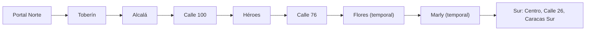

# FlowTM: Gemelo Digital de Simulación Físico-Estocástica con IA para TransMilenio

[](https://github.com/TheLudway/FlowTM)
[](https://github.com/TheLudway/FlowTM)
[](https://www.python.org/)
[](https://docs.astral.sh/uv/)
[](https://react.dev/)
[](LICENSE)

**FlowTM** (*Flow TransMilenio*) es un **Gemelo Digital físico-estocástico por eventos discretos (DES)** impulsado por Inteligencia Artificial y agentes racionales con optimización heurística, concebido para el modelado matemático riguroso y la optimización de frecuencias del sistema BRT (*Bus Rapid Transit*) de Bogotá D.C.

Incluye un **Centro de Control de Operaciones (OCC)** interactivo a 60 FPS desarrollado en **React 19 + MapLibre GL** que permite auditar telemetría geoespacial, evaluar la evolución de colas en andenes en tiempo real y ejecutar comparativas de pantalla dividida (*split-screen*) entre el escenario base vigente y la política optimizada generada por el agente racional.

---

## 📚 Documentación Oficial en la Wiki de GitHub

Para una revisión exhaustiva de la formulación matemática, arquitectura, algoritmos de IA y manuales, consulte los capítulos oficiales en la **[Wiki de FlowTM](https://github.com/TheLudway/FlowTM/wiki)**:

| Sección | Documento en la Wiki | Descripción |
| :---: | :--- | :--- |
| 📖 **Home** | [**Wiki Oficial de FlowTM**](https://github.com/TheLudway/FlowTM/wiki/Home) | Portada, mapa temático, ficha técnica y licenciamiento abierto. |
| 📐 **Proyecto** | [**Información General y Modelado Físico**](https://github.com/TheLudway/FlowTM/wiki/Info-General) | Los 8 modelos analíticos acoplados (Poisson NHPP, colas $Q(t)$, TCQSM dwell time, cinemática Haversine, bunching y ley de flota). |
| 🏛️ **Proyecto** | [**Arquitectura de Software y Patrones**](https://github.com/TheLudway/FlowTM/wiki/Arquitectura) | Clean Architecture Hexagonal, patrones GoF (Observer, Strategy, State), in-memory con Polars/Arrow y resolución del Issue #19. |
| 🤖 **IA & Sim** | [**Agente Racional y Optimización Heurística**](https://github.com/TheLudway/FlowTM/wiki/Agente-IA-Optimizacion) | Formulación PEAS, utilidad esperada $U(S)$, cota física de flota, recocido simulado calibrado, comparación de algoritmos y validación fuera de muestra. |
| 🖥️ **IA & Sim** | [**Centro de Control de Operaciones (OCC)**](https://github.com/TheLudway/FlowTM/wiki/Centro-de-Control-OCC) | Arquitectura React 19 + MapLibre GL a 60 FPS, tokens de diseño HSL, modo split-screen, inspector vehicular y analítica en 4 fases. |
| 🚀 **IA & Sim** | [**Guía de Ejecución y Reproducibilidad**](https://github.com/TheLudway/FlowTM/wiki/Simulador-Guia-Ejecucion) | Manual paso a paso con `uv` y `bun`, pipelines de datos (`01`, `02`, `03`), exportador GTFS y suite de pruebas `pytest`. |

---

## 📌 Alcance del Gemelo Digital (derivado de datos abiertos)

Todo el escenario se construye con `scripts/01_preparar_escenario.py` a partir del **GTFS oficial de TransMilenio (27/07/2026)** y de las **validaciones y salidas limpias del recaudo** (`*_clean.parquet`); no hay rutas, intervalos ni tiempos escritos a mano.



* **Corredor:** Portal Norte → Marly, **sentido sur**, pico AM 06:00–09:00. Los datos confirman la dirección: en la mañana las entradas se concentran al norte y las salidas al sur (Calle 100 recibe 9 veces más salidas que entradas).
* **Topología:** 19 estaciones operativas según el GTFS. Calle 72, Calle 63 y Calle 45 no tienen servicio troncal en 2026 (obras); las estaciones temporales de la Caracas se cruzan por nombre con sus códigos del recaudo.
* **Oferta:** los **18 servicios troncales** que cruzan el corredor hacia el sur, con su patrón real de paradas, intervalo medio del pico y tiempos de recorrido por tramo. El agente optimiza **6 servicios** —H13, H75, H27, J74, K23 y L18, contrapartes hacia el sur de B13…B75— y los otros 12 operan con su frecuencia GTFS.
* **Bahías:** número oficial de vagones por estación (infraestructura troncal) o plataformas GTFS en los portales.
* **Demanda:** llegadas de Poisson no homogéneas por estación y franja de 15 min desde las validaciones de días hábiles, repartidas por sentido y destino con un modelo gravitacional sobre las salidas AM observadas (el recaudo troncal no registra el destino de cada viaje).
* **Flota física:** cada ruta optimizable tiene sus buses reales en circuito cerrado (ida + regreso + regulación); si no hay bus en cabecera, la salida se retrasa.
* **Cota sin CAPEX:** $B_{\max} = 244$ buses, la flota que exige hoy el GTFS para esas 6 rutas con sus regresos (ley de Little por sentido). Validación independiente en el GTFS: 243 buses en viaje en el instante pico + ~13 en regulación.

---

## 🧠 El Agente Racional

* **Utilidad esperada:** cada horario se evalúa con 5 semillas de simulación usando números aleatorios comunes (reducción de varianza) y en paralelo.
* **Recocido simulado calibrado:** la temperatura inicial se estima de los datos para aceptar ~80% de los empeoramientos al inicio (regla de Kirkpatrick) y se enfría geométricamente hasta 1% de $T_0$. El vecindario combina intercambios de frecuencia entre rutas y cambios de una sola ruta, y nunca genera horarios que excedan la cota de flota.
* **Validación fuera de muestra:** el mejor horario se compara con la operación actual en 30 semillas que la búsqueda nunca vio (diferencia pareada, IC 95%).

### Resultados (`scripts/03_optimizar_frecuencias.py`, validación con 30 semillas nuevas)

| Indicador | Operación actual (GTFS) | Agente FlowTM | Diferencia (IC 95%) |
| :--- | :---: | :---: | :---: |
| **Utilidad multicriterio** $U(S)$ | −2.0243 | **−2.0063** | **+0.0180** [+0.0036, +0.0324] ✅ |
| **Buses con sobrecupo crítico** (≥ 95%) | 8.10% | **7.52%** | **−7.1%** [−0.89, −0.26 pts] ✅ |
| Tiempo medio de espera | 3.506 min | 3.517 min | +0.31% [+0.004, +0.018 min] |
| Pasajeros varados al corte (09:00) | 1,685 | 1,694 | +0.6% (no significativo) |
| Pasajeros transportados | 54,122 | 54,112 | −0.02% (no significativo) |
| Flota física | 244 | **243** | −1 bus |

> [!NOTE]
> **Lectura honesta.** El agente encuentra un compromiso: reasigna frecuencia de K23 y L18 (poco cargadas) hacia J74 y H27, reduce el hacinamiento un 7% y libera un bus, a costa de unos segundos más de espera media. Con los pesos del Avance II (0.40 espera, 0.30 sobrecupo, 0.15 varados, 0.15 flota) ese compromiso mejora $U(S)$ de forma significativa. La meta de reducir la espera en ≥ 15% **no es alcanzable** redistribuyendo la flota actual de estas 6 rutas. Los pesos pueden ajustarse en el **Laboratorio IA** del OCC para explorar otros compromisos.

### ¿Por qué recocido simulado? (`scripts/05_comparar_algoritmos.py`)

Mismo presupuesto (100 horarios × 5 semillas), 3 corridas por algoritmo, validación con 30 semillas nuevas:

| Algoritmo | ΔU en validación (media [rango]) | Mejoras significativas |
| :--- | :---: | :---: |
| Búsqueda aleatoria | +0.0000 [+0.0000, +0.0000] | 0/3 |
| Hill climbing | +0.0001 [−0.0051, +0.0106] | 0/3 |
| **Recocido simulado** | **+0.0179** [+0.0133, +0.0214] | **3/3** |

La búsqueda aleatoria nunca supera al horario diseñado por TransMilenio; hill climbing se estanca en óptimos locales; el recocido simulado escapa de ellos y mejora de forma consistente.

---

## 🛠️ Stack Tecnológico

```
┌────────────────────────────────────────────────────────┐
│                        FLOWTM STACK                    │
├──────────────────────────┬─────────────────────────────┤
│ Backend & Simulación     │ Python 3.12, SimPy, uv      │
│ In-Memory Data Pipeline  │ Apache Arrow, Polars, ZSTD  │
│ Inteligencia Artificial  │ SA calibrado, HC, búsqueda  │
│ API del agente           │ FastAPI + SSE (en vivo)     │
│ Frontend OCC             │ React 19, TypeScript, Bun   │
│ Motor Geoespacial WebGL  │ MapLibre GL JS 5.x (60 FPS) │
│ Estándar de Transporte   │ General Transit Feed (GTFS) │
│ Testing & Calidad        │ Pytest (42 tests), Ruff     │
└──────────────────────────┴─────────────────────────────┘
```

---

## 🚀 Inicio Rápido (Quickstart)

### 1. Clonación e Instalación de Dependencias

```bash
git clone https://github.com/TheLudway/FlowTM.git
cd FlowTM

# Configurar backend con uv
uv sync

# Configurar frontend con bun
cd frontend
bun install
cd ..
```

### 2. Ejecutar Pipelines de Simulación e Inteligencia Artificial

```bash
# Paso 1: Construir el escenario desde el GTFS y el recaudo limpio
uv run python scripts/01_preparar_escenario.py

# Paso 2: Simular la operación actual (frecuencias GTFS)
uv run python scripts/02_correr_simulador_base.py

# Paso 3: Agente racional (recocido simulado) + validación con 30 semillas nuevas (~1.5 min)
uv run python scripts/03_optimizar_frecuencias.py

# Paso 4: Exportar la telemetría y los resultados al frontend (frontend/public/data)
uv run python scripts/export_frontend_data.py

# (Opcional) Monte Carlo del horario optimizado y experimento de algoritmos (~10 min)
uv run python scripts/04_validar_robustez.py
uv run python scripts/05_comparar_algoritmos.py
```

### 3. Iniciar el Centro de Control de Operaciones (OCC)

```bash
# Terminal 1: API del agente (necesaria para el Laboratorio IA)
uv run uvicorn flowtm.api.app:app --port 8000

# Terminal 2: frontend
cd frontend
bun run dev
```

Abra **`http://localhost:5173`**. Además del mapa y la analítica, la pestaña **Laboratorio IA** permite elegir el algoritmo, el presupuesto, la cota de flota y los pesos de $U(S)$, ver la convergencia del agente en vivo, revisar la validación estadística y cargar el horario encontrado en el mapa comparativo.

### 4. Ejecutar Suite de Pruebas Automatizadas

```bash
uv run pytest tests -q
```

### 5. Ejecutar con Docker Compose

Docker Compose construye el backend FastAPI y el frontend React servido por Nginx.
Antes de arrancar, asegúrese de tener disponibles los insumos procesados en
`data/processed/`. El servicio `pipeline` ejecuta automáticamente los notebooks de conversión y
limpieza (Marimo) y después los pasos `01_preparar_escenario.py`,
`02_correr_simulador_base.py`, `03_optimizar_frecuencias.py` y
`export_frontend_data.py`; así regenera desde cero la telemetría que consume el
mapa. Los datos crudos y procesados no se copian a la imagen porque ocupan
varios GB: se montan desde `data/raw/` y `data/processed/`.

```bash
docker compose up --build -d
docker compose ps
docker compose logs -f
```

El frontend publica también la API bajo `/api`. Abra **`http://localhost:8080`**
cuando `pipeline` haya terminado y `backend` aparezca como `healthy`. El puerto puede cambiarse con
`FLOWTM_PORT=9000 docker compose up --build -d`. Para detener los servicios:

```bash
docker compose down
```

---

## 👥 Equipo de Investigación y Créditos

Proyecto desarrollado en el marco del programa de **Ingeniería de Sistemas y Computación (2026)**:

* **Ludwig Alvarado** — *Arquitectura de Software y Modelado Estocástico* ([@TheLudway](https://github.com/TheLudway))
* **Kevin Adrian Pinilla Naranjo** — *Ingeniería de Simulación, IA Heurística y Frontend OCC* ([@KevinAPN](https://github.com/KevinAPN))
* **Albert Geovanny Mahecha Reyes** — *Pipelines de Big Data y Calibración Empírica* ([@mahecha08](https://github.com/mahecha08))
* **Maria Fernanda Ospina Rocha** — *Formulación de Modelos y Análisis Operativo* ([@mf-ospina](https://github.com/mf-ospina))

---

## 📄 Licenciamiento

* **Código de Software:** [GNU General Public License v3.0 (GPL-3.0-or-later)](https://www.gnu.org/licenses/gpl-3.0.html).
* **Modelos, Documentación y Diseños:** [Creative Commons Attribution 4.0 International (CC-BY-4.0)](https://creativecommons.org/licenses/by/4.0/).
