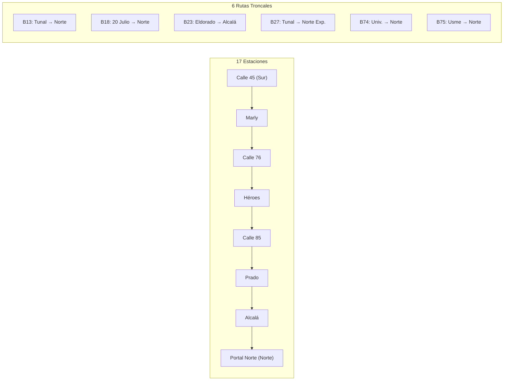

# FlowTM: Gemelo Digital de Simulación Físico-Estocástica con IA para TransMilenio

[](https://github.com/TheLudway/FlowTM)
[](https://github.com/TheLudway/FlowTM)
[](https://www.python.org/)
[](https://docs.astral.sh/uv/)
[](https://react.dev/)
[](LICENSE)

**FlowTM** (*Flow TransMilenio*) es un **Gemelo Digital físico-estocástico por eventos discretos (DES)** impulsado por Inteligencia Artificial y agentes racionales con optimización heurística, concebido para el modelado matemático riguroso y la optimización de frecuencias del sistema BRT (*Bus Rapid Transit*) de Bogotá D.C.

Incluye un **Centro de Control de Operaciones (OCC)** interactivo a 60 FPS desarrollado en **React 19 + MapLibre GL** que permite auditar telemetría geoespacial, evaluar la evolución de colas en andenes en tiempo real y ejecutar comparativas de pantalla dividida (*split-screen*) entre el escenario base vigente y la política optimizada generada por el agente racional.

---

## 📚 Documentación Oficial en la Wiki de GitHub

Para una revisión exhaustiva de la formulación matemática, arquitectura, algoritmos de IA y manuales, consulte los capítulos oficiales en la **[Wiki de FlowTM](https://github.com/TheLudway/FlowTM/wiki)**:

| Sección | Documento en la Wiki | Descripción |
| :---: | :--- | :--- |
| 📖 **Home** | [**Wiki Oficial de FlowTM**](https://github.com/TheLudway/FlowTM/wiki/Home) | Portada, mapa temático, ficha técnica y licenciamiento abierto. |
| 📐 **Proyecto** | [**Información General y Modelado Físico**](https://github.com/TheLudway/FlowTM/wiki/Info-General) | Los 8 modelos analíticos acoplados (Poisson NHPP, colas $Q(t)$, TCQSM dwell time, cinemática Haversine, bunching y ley de flota). |
| 🏛️ **Proyecto** | [**Arquitectura de Software y Patrones**](https://github.com/TheLudway/FlowTM/wiki/Arquitectura) | Clean Architecture Hexagonal, patrones GoF (Repository, Observer, Strategy, State), in-memory con Polars/Arrow y resolución del Issue #19. |
| 🤖 **IA & Sim** | [**Agente Racional y Optimización Heurística**](https://github.com/TheLudway/FlowTM/wiki/Agente-IA-Optimizacion) | Formulación PEAS (Avance II), función de utilidad $U(S)$, cota física $\le 106$ buses, Recocido Simulado en $\mathbb{R}^6$ y matriz de metas. |
| 🖥️ **IA & Sim** | [**Centro de Control de Operaciones (OCC)**](https://github.com/TheLudway/FlowTM/wiki/Centro-de-Control-OCC) | Arquitectura React 19 + MapLibre GL a 60 FPS, tokens de diseño HSL, modo split-screen, inspector vehicular y analítica en 4 fases. |
| 🚀 **IA & Sim** | [**Guía de Ejecución y Reproducibilidad**](https://github.com/TheLudway/FlowTM/wiki/Simulador-Guia-Ejecucion) | Manual paso a paso con `uv` y `bun`, pipelines de datos (`01`, `02`, `03`), exportador GTFS y suite de pruebas `pytest`. |

---

## 📌 Alcance Operativo del Corredor Modelado



* **Corredor Modelado:** Troncal Caracas – Autopista Norte (Sentido Sur $\rightarrow$ Norte en franja pico matutina 06:00 a 09:00 AM, 180 min de operación continua).
* **Extensión Topológica:** 17 estaciones consecutivas modeladas desde *Calle 45* hasta *Portal Norte*.
* **Rutas Troncales Activas:** `B13`, `B18`, `B23`, `B27`, `B74` y `B75`.
* **Demanda Empírica Calibrada:** 44.93 millones de registros del sistema de recaudo *tullave* (validaciones de entrada y descensos en torniquete) procesados con Apache Arrow y Polars.
* **Restricción Física Presupuestal:** Cota dura de máximo **106 buses físicos** articulados simultáneos (**$0 USD en gasto de capital / $0 CAPEX**).

---

## 🏆 Resultados del Agente Racional

Resultados reproducibles de `scripts/03_optimizar_frecuencias.py` (30 iteraciones de Recocido Simulado, semilla `42`, franja 06:00–09:00):

| Métrica Operacional | Escenario Base (GTFS Vigente) | Escenario Optimizado (FlowTM) | Variación |
| :--- | :---: | :---: | :---: |
| **Flota física requerida** $\sum_r \lceil T_r / h_r \rceil$ | 106 buses | **92 buses** | **-14 buses (-13.2%)** |
| **Tiempo medio de espera en andén** ($\bar{W}$) | 3.67 min | **3.45 min** | **-6.1%** |
| **Buses con sobrecupo crítico** (≥ 95%) | 7.4% | **6.4%** | -1.0 pts |
| **Pasajeros varados al corte** (09:00) | 1,273 | 1,322 | +3.8% |
| **Pasajeros transportados** | 48,899 | 48,850 | -0.1% |
| **Ocupación promedio de la flota** | 43.1% | 42.8% | -0.3 pts |
| **Utilidad multicriterio** $U(S)$ (costo negativo) | $U_0 = -1.9981$ | **$U^* = -1.8602$** | **$\Delta U = +0.1379$** |
| **Entregable** | Horarios estáticos | `frequencies.txt` | Estándar GTFS |

> [!NOTE]
> **Lectura de los resultados.** El agente libera 14 buses manteniendo prácticamente el mismo volumen transportado y reduciendo la espera media un 6.1%. La mejora es moderada: la meta del Avance II de reducir la espera en ≥ 15% **aún no se alcanza**, y los pasajeros varados al corte aumentan ligeramente (+3.8%).
>
> **Flota física vs. despachos.** La flota física (92 buses) es el número de vehículos distintos necesarios para sostener los intervalos. Como cada bus completa varios ciclos en las 3 horas, el escenario optimizado registra **354 despachos** (420 en el escenario base).

---

## 🛠️ Stack Tecnológico

```
┌────────────────────────────────────────────────────────┐
│                        FLOWTM STACK                    │
├──────────────────────────┬─────────────────────────────┤
│ Backend & Simulación     │ Python 3.12, SimPy, uv      │
│ In-Memory Data Pipeline  │ Apache Arrow, Polars, ZSTD  │
│ Inteligencia Artificial  │ Simulated Annealing (SA)    │
│ Frontend OCC             │ React 19, TypeScript, Bun   │
│ Motor Geoespacial WebGL  │ MapLibre GL JS 5.x (60 FPS) │
│ Estándar de Transporte   │ General Transit Feed (GTFS) │
│ Testing & Calidad        │ Pytest (15 tests), Ruff     │
└──────────────────────────┴─────────────────────────────┘
```

---

## 🚀 Inicio Rápido (Quickstart)

### 1. Clonación e Instalación de Dependencias

```bash
git clone https://github.com/TheLudway/FlowTM.git
cd FlowTM

# Configurar backend con uv
uv sync

# Configurar frontend con bun
cd frontend
bun install
cd ..
```

### 2. Ejecutar Pipelines de Simulación e Inteligencia Artificial

```bash
# Paso 1: Procesar datos brutos de TuLlave y GTFS a Parquet
uv run python scripts/01_preparar_escenario.py

# Paso 2: Ejecutar simulación del Escenario Base (106 buses)
uv run python scripts/02_correr_simulador_base.py

# Paso 3: Optimizar frecuencias con el Agente Heurístico (cota <= 106 buses)
uv run python scripts/03_optimizar_frecuencias.py

# Paso 4: Exportar la telemetría y los resultados al frontend (frontend/public/data)
uv run python scripts/export_frontend_data.py
```

### 3. Iniciar el Centro de Control de Operaciones (OCC)

```bash
cd frontend
bun run dev
```

Abra el navegador en **`http://localhost:5173`** para interactuar con el Centro de Control a 60 FPS, navegar con el scrubber temporal, activar la vista de **Pantalla Dividida** e inspeccionar la telemetría en vivo.

### 4. Ejecutar Suite de Pruebas Automatizadas

```bash
uv run pytest tests -v
```

Verificación esperada:
```text
============================== 15 passed in 1.4s ==============================
```

---

## 👥 Equipo de Investigación y Créditos

Proyecto desarrollado en el marco del programa de **Ingeniería de Sistemas y Computación (2026)**:

* **Ludwig Alvarado** — *Arquitectura de Software y Modelado Estocástico* ([@TheLudway](https://github.com/TheLudway))
* **Kevin Adrian Pinilla Naranjo** — *Ingeniería de Simulación, IA Heurística y Frontend OCC* ([@KevinAPN](https://github.com/KevinAPN))
* **Albert Geovanny Mahecha Reyes** — *Pipelines de Big Data y Calibración Empírica* ([@mahecha08](https://github.com/mahecha08))
* **Maria Fernanda Ospina Rocha** — *Formulación de Modelos y Análisis Operativo* ([@mf-ospina](https://github.com/mf-ospina))

---

## 📄 Licenciamiento

* **Código de Software:** [GNU General Public License v3.0 (GPL-3.0-or-later)](https://www.gnu.org/licenses/gpl-3.0.html).
* **Modelos, Documentación y Diseños:** [Creative Commons Attribution 4.0 International (CC-BY-4.0)](https://creativecommons.org/licenses/by/4.0/).
