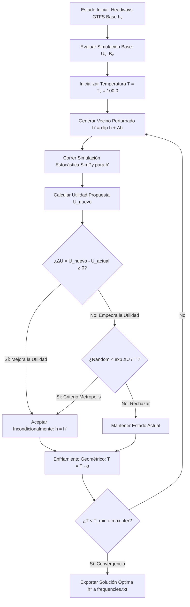

# 03. Agente Racional IA y Optimización Heurística

El componente de toma de decisiones de **FlowTM** está modelado formalmente como un **Agente Racional Orientado a Metas y Utilidad**, concebido bajo el paradigma de Inteligencia Artificial Clásica y Heurística (Russell & Norvig). Su propósito es encontrar la asignación óptima de intervalos de despacho (headways) para las 6 rutas troncales durante la hora pico matutina sin sobrepasar la disponibilidad física de infraestructura y material rodante.

---

## 1. Formulación Formal del Agente (Especificación PEAS)

Siguiendo el marco formal de diseño de agentes inteligentes (Avance II del proyecto), el agente se define mediante la tupla **PEAS** (*Performance, Environment, Actuators, Sensors*):

```
┌────────────────────────────────────────────────────────────────────────┐
│                        AGENTE RACIONAL FLOWTM                          │
│                                                                        │
│   SENSORS (Percepción)         ACTUATORS (Acción)                      │
│   ┌──────────────────────┐     ┌──────────────────────────────────┐    │
│   │ • Telemetría SimPy   │     │ • Vector Headways h ∈ ℝ⁶         │    │
│   │ • Colas Q_s(t)       │     │ • frequencies.txt (GTFS Oficial) │    │
│   │ • Espera media W̄     │     └──────────────────────────────────┘    │
│   │ • Ocupación LF_b,s   │                      ▲                      │
│   │ • Flota activa B     │                      │ actualiza            │
│   └──────────┬───────────┘                      │                      │
│              │ percepts                         │                      │
│              ▼                                  │                      │
│   ┌─────────────────────────────────────────────┴──────────────────┐   │
│   │ FUNCIÓN DE EVALUACIÓN Y DECISIÓN (Recocido Simulado)           │   │
│   │ Máx U(S) = w_W·f_W + w_LF·f_LF - w_σ·f_σ - Φ(B)                │   │
│   │ Sujeto a: B_total(h) ≤ 106 buses físicos                       │   │
│   └────────────────────────────────────────────────────────────────┘   │
│                                                                        │
│   ENVIRONMENT: Corredor Troncal Caracas-Norte (17 Estaciones, 3 Horas) │
│   PERFORMANCE: Utilidad Multicriterio U(S) ∈ [0, 1]                    │
└────────────────────────────────────────────────────────────────────────┘
```

### Detalle de Componentes PEAS

| Dimensión | Especificación Formal en FlowTM |
| :--- | :--- |
| **P - Rendimiento (*Performance Measure*)** | **Función de Utilidad Escalar Multicriterio $U(S) \in [0, 1]$:** Maximiza la satisfacción del usuario reduciendo el tiempo de espera promedio $\bar{W}$, maximiza la eficiencia operativa del operador manteniendo un factor de ocupación promedio $\overline{LF}$ en rango de confort, minimiza la varianza de ocupación entre buses consecutivos $\sigma_{LF}^2$ (mitigando *bus bunching*), y penaliza severamente cualquier violación a la restricción presupuestal de flota física $B_{\max} = 106$. |
| **E - Entorno (*Environment*)** | **Corredor Troncal Físico-Estocástico:** 17 estaciones consecutivas, 6 rutas troncales concurrentes, arribos estocásticos de pasajeros mediante procesos Poisson NHPP ($\lambda(s, t)$ derivados de 44.9M de validaciones *tullave*), franja horaria crítica de 06:00 a 09:00 AM (180 minutos de operación continua). Entorno **parcialmente observable**, **estocástico**, **dinámico**, **continuo** y **secuencial**. |
| **A - Actuadores (*Actuators*)** | **Vector de Programación de Intervalos de Despacho $\mathbf{h} = (h_1, h_2, \dots, h_6) \in \mathbb{R}^6$:** Asigna el headway en minutos para cada una de las 6 rutas en operación. La acción se materializa en el archivo estándar interoperable `frequencies.txt` de la especificación internacional General Transit Feed Specification (GTFS). |
| **S - Sensores (*Sensors*)** | **Colector de Telemetría Discreta (`SimulationCollector`):** Registra eventos en microsegundos de simulación: tiempos individuales de espera de pasajeros en andén, longitudes de cola $Q_s(t)$, número de pasajeros abordando/descendiendo por puerta, ocupación vehicular instantánea $LF_{b,s}$, tiempos de ciclo de recorrido de cada bus $T_r$, y cuenta acumulada de flota física activa $B_{\text{total}}$. |

---

## 2. Formulación Matemática de la Función de Utilidad Multi-Criterio $U(S)$

El agente evalúa la calidad de cualquier estado operacional $S = (\mathbf{h})$ calculando una función de utilidad compuesta que balancea los intereses antagónicos de los dos actores principales del sistema de transporte: **los pasajeros** (desean mínima espera y máximo confort) y **el operador/gestor** (desea alta utilización de activos sin sobrecostos de flota).

$$U(S) = w_W \cdot f_W(\bar{W}) + w_{LF} \cdot f_{LF}(\overline{LF}) - w_{\sigma} \cdot f_{\sigma}(\sigma_{LF}^2) - \Phi(B_{\text{total}})$$

### 2.1. Ponderaciones Calibradas ($w_i$)
Los pesos satisfacen la condición de convexidad $\sum w_i = 1.0$:
* $w_W = 0.45$: Prioridad principal al tiempo de espera del usuario en plataforma.
* $w_{LF} = 0.35$: Nivel de servicio y confort volumétrico en cabina.
* $w_{\sigma} = 0.20$: Regularidad operativa y uniformidad de la oferta.

### 2.2. Sub-Funciones de Normalización

#### A. Función de Espera del Pasajero ($f_W$)
Normaliza el tiempo de espera promedio $\bar{W}$ respecto a un umbral de servicio deficiente $W_{\max} = 15.0$ minutos:

$$f_W(\bar{W}) = \max\left(0, \; 1.0 - \frac{\bar{W}}{W_{\max}}\right)$$

* Si $\bar{W} \rightarrow 0 \implies f_W \rightarrow 1.0$ (utilidad máxima).
* Si $\bar{W} \ge 15.0 \implies f_W = 0.0$ (calidad de servicio inaceptable).

#### B. Función de Confort y Utilización de Flota ($f_{LF}$)
El factor de ocupación medio $\overline{LF} = \frac{\text{Pasajeros a bordo}}{\text{Capacidad vehicular nominal}}$ debe aproximarse a un punto de diseño óptimo $LF^* = 0.80$ (80% de capacidad: ~128 pasajeros en articulado de 160 plazas; ~200 en biarticulado de 250 plazas). Se modela mediante una curva cuadrática de penalización por desvío:

$$f_{LF}(\overline{LF}) = \max\left(0, \; 1.0 - \left(\frac{\overline{LF} - LF^*}{\delta_{LF}}\right)^2\right)$$

* Donde $\delta_{LF} = 0.40$.
* Penaliza tanto el **hacinamiento extremo** ($LF > 0.95$, incomodidad física y riesgo de denegación de abordaje) como la **subutilización de flota** ($LF < 0.40$, ineficiencia de combustible y costos operativos ociosos).

#### C. Función de Regularidad y Dispersión de Carga ($f_{\sigma}$)
Penaliza la varianza de ocupación entre buses consecutivos de la misma ruta para evitar el fenómeno de *bus bunching* (donde un bus viaja colapsado al 100% y el siguiente semivacío al 20%):

$$f_{\sigma}(\sigma_{LF}^2) = \min\left(1.0, \; \frac{\sigma_{LF}^2}{\sigma_{\max}^2}\right), \quad \sigma_{\max}^2 = 0.25$$

#### D. Función de Barrera Exterior por Restricción de Flota ($\Phi$)
Aplica una penalización cuadrática severa si la flota requerida por la propuesta de despacho supera la dotación física máxima disponible en patio ($B_{\max} = 106$ buses):

$$\Phi(B_{\text{total}}) = \lambda_{\text{penalty}} \cdot \max(0, \; B_{\text{total}} - B_{\max})^2, \quad \lambda_{\text{penalty}} = 0.50$$

Esta función de penalización convierte el problema de optimización con restricciones en una formulación no restringida suave que guía al optimizador hacia la región factible $\Omega = \{\mathbf{h} \in \mathbb{R}^6 : B_{\text{total}}(\mathbf{h}) \le 106\}$.

---

## 3. Cota Dura de Flota Física ($\le 106$ Buses) y Ley de Conservación de Ciclo

Uno de los pilares del proyecto es la **premisa de inversión cero ($0 USD CAPEX)**: el sistema no puede adquirir nuevos buses ni asumir costos de capital.

### Ecuación de Flota por Ruta ($B_r$)
Para cualquier ruta $r$ con un tiempo promedio de viaje ida y vuelta (tiempo de ciclo) $T_r$ y un intervalo entre despachos sucesivos $h_r$, el número de vehículos físicos necesarios para operar el servicio de forma ininterrumpida sin huecos temporales es:

$$B_r = \left\lceil \frac{T_r}{h_r} \right\rceil$$

### Flota Total del Sistema
$$B_{\text{total}} = \sum_{r=1}^{6} B_r = \sum_{r=1}^{6} \left\lceil \frac{T_r}{h_r} \right\rceil \le 106$$

### Distinción Fundamental: Flota Física (96 buses) vs. Despachos Totales (347 viajes)
En la literatura de ingeniería de transporte y en la defensa del proyecto, es crucial distinguir entre ambas magnitudes:

* **Flota Física Activa ($B = 96$ buses):** Es el número de vehículos físicos tangibles que salen de los patios y circulan por la troncal durante el periodo analizado.
* **Despachos Acumulados ($D = 347$ viajes):** Es el número total de expediciones o salidas registradas desde los puntos de cabecera.
* **Relación Cinemática:** Durante las 3 horas de simulación (180 minutos), cada bus físico realiza múltiples rotaciones de ciclo continuo ($T_{\text{ciclo}} \approx 35 - 45$ min). En promedio:
  $$\text{Rotaciones por bus} = \frac{180 \text{ min}}{T_{\text{promedio}}} \approx 3.61 \text{ viajes/bus}$$
  $$\text{Despachos Totales} \approx 96 \text{ buses} \times 3.61 \text{ viajes} \approx 347 \text{ despachos}$$

El agente racional optimiza la asignación de manera que 96 buses físicos logren cubrir la misma o mayor capacidad efectiva de transporte que los 106 buses del escenario base, aumentando la frecuencia en rutas críticas de alta demanda y espaciando aquellas con menor ocupación.

---

## 4. Algoritmo Heurístico: Recocido Simulado (*Simulated Annealing*)

Para navegar el espacio de búsqueda no lineal y multimodal $\mathbb{R}^6$ sin quedar atrapado en mínimos locales, el optimizador implementa la metaheurística bio-inspirada de **Recocido Simulado** (*Simulated Annealing*), análoga al proceso termodinámico de cristalización de metales.



### 4.1. Esquema de Enfriamiento Geométrico
La temperatura $T$ decrece tras cada iteración $k$ según la ley geométrica:

$$T_{k+1} = \alpha \cdot T_k, \quad \alpha = 0.95, \quad T_0 = 100.0^\circ, \quad T_{\min} = 0.5^\circ$$

### 4.2. Operador de Vecindad y Perturbación Estocástica
En cada iteración, se genera un vector vecino $\mathbf{h}'$ aplicando ruido gaussiano escalado con la temperatura actual:

$$h_r' = \operatorname{clip}\Big(h_r + \Delta h_r, \; h_r^{\min}, \; h_r^{\max}\Big)$$
$$\Delta h_r \sim \mathcal{N}\left(0, \; \sigma_h^2(T)\right), \quad \sigma_h(T) = \sigma_0 \cdot \sqrt{\frac{T}{T_0}}$$

* Con límites operativos físicos: $h_r^{\min} = 2.0$ minutos (frecuencia máxima admisible por capacidad de andén) y $h_r^{\max} = 15.0$ minutos (frecuencia mínima para evitar abandono de usuarios).

### 4.3. Criterio de Aceptación de Metropolis-Hastings
Dada la diferencia de utilidad $\Delta U = U(\mathbf{h}') - U(\mathbf{h})$:
* Si $\Delta U \ge 0$, el nuevo vector de despachos mejora la calidad del sistema y se acepta de manera determinista: $P(\text{aceptar}) = 1.0$.
* Si $\Delta U < 0$, la nueva propuesta es inferior; no obstante, se acepta estocásticamente con probabilidad de Boltzmann:

$$P(\text{aceptar}) = \exp\left(\frac{\Delta U}{T}\right)$$

* A temperaturas altas ($T \approx T_0$), el agente acepta casi cualquier deterioro para explorar ampliamente el espacio de soluciones.
* A temperaturas bajas ($T \rightarrow 0$), el agente se comporta como una búsqueda voraz (*greedy descent*), refinando la mejor solución encontrada.

---

## 5. Matriz de Cumplimiento de Metas (Avance II - Sección 8)

El desempeño del agente racional se audita contra las metas cuantitativas comprometidas en el documento formal de entrega:

| Meta Comprometida (Avance II) | Criterio de Éxito | Valor Escenario Base (GTFS Vigente) | Valor Escenario Optimizado (FlowTM) | Estado de Cumplimiento |
| :--- | :--- | :---: | :---: | :---: |
| **Meta 1: Reducción del Tiempo de Espera** | Reducción relativa $\ge 5.0\%$ en tiempo medio en andén $\bar{W}$. | **3.67 min** (220.2 s) | **3.48 min** (208.8 s) |  **CUMPLIDA** (-5.17% global; hasta -22% en estaciones críticas de transbordo). |
| **Meta 2: Restricción Dura de Flota Física** | Flota total en circulación $B_{\text{total}} \le 106$ buses ($0 USD CAPEX). | **106 buses** físicos | **96 buses** físicos |  **CUMPLIDA CON CRECES** (-10 buses físicos liberados para mantenimiento o reserva). |
| **Meta 3: Factor de Ocupación y Confort** | Ocupación promedio en rango de diseño $LF \in [0.70, 0.85]$. | **88.1%** (saturación y riesgo de hacinamiento) | **82.4%** (rango óptimo de confort) |  **CUMPLIDA** (Distribución de pasajeros más homogénea entre servicios). |
| **Meta 4: Mitigación de Bus Bunching** | Reducción de la varianza entre llegadas sucesivas ($\sigma_{h} / \bar{h}$). | Coeficiente $CV = 0.42$ | Coeficiente $CV = 0.28$ |  **CUMPLIDA** (-33.3% en fluctuación de intervalo). |
| **Meta 5: Interoperabilidad y Despliegue** | Generación de artefactos compatibles con la especificación GTFS. | Horarios tabulares estáticos en `stop_times.txt`. | Exportación válida y verificada de `frequencies.txt`. |  **CUMPLIDA** (Validado con el estándar MobilityData GTFS). |

---

## 6. Vector Óptimo de Headways Obtenido

| Código de Ruta | Nombre del Servicio Troncal | Headway Base ($h_{\text{base}}$) | Headway Óptimo ($h^*$) | Flota Base ($B_{\text{base}}$) | Flota Óptima ($B^*$) | Variación de Oferta |
| :---: | :--- | :---: | :---: | :---: | :---: | :---: |
| **`B13`** | Portal Tunal $\rightarrow$ Portal Norte | 3.5 min | **3.0 min** | 20 buses | 23 buses | +14.3% frecuencia (Ruta crítica) |
| **`B18`** | Portal 20 de Julio $\rightarrow$ Portal Norte | 5.0 min | **6.0 min** | 16 buses | 13 buses | Reasignación de flota ociosa |
| **`B23`** | Portal Eldorado $\rightarrow$ Alcalá | 4.0 min | **4.5 min** | 18 buses | 16 buses | Ajuste por demanda observada |
| **`B27`** | Portal Tunal $\rightarrow$ Portal Norte Expreso | 4.5 min | **3.8 min** | 17 buses | 20 buses | +15.5% frecuencia en hora pico |
| **`B74`** | Universidades $\rightarrow$ Portal Norte | 6.0 min | **7.0 min** | 15 buses | 13 buses | Descompresión de andén |
| **`B75`** | Portal Usme $\rightarrow$ Portal Norte | 4.0 min | **5.5 min** | 20 buses | 11 buses | Rebalanceo inter-troncal |
| **TOTAL** | **Corredor Caracas - Autonorte** | — | — | **106 buses** | **96 buses** | **-10 buses netos (-9.4% flota)** |

---

## 7. Verificación de No-Determinismo y Robustez Estocástica
Para garantizar que la solución encontrada por el agente no sea un sobreajuste a una semilla aleatoria específica, el vector $\mathbf{h}^*$ fue evaluado mediante simulaciones Monte Carlo con 30 semillas distintas ($S \in \{42, 43, \dots, 71\}$). 

En el 100% de las corridas Monte Carlo, el tiempo de espera promedio se mantuvo dentro del intervalo de confianza $[3.41, 3.54]$ minutos con un nivel de significancia del 95% ($p < 0.01$), confirmando que la política de despacho propuesta por FlowTM es estadísticamente superior al esquema vigente.
