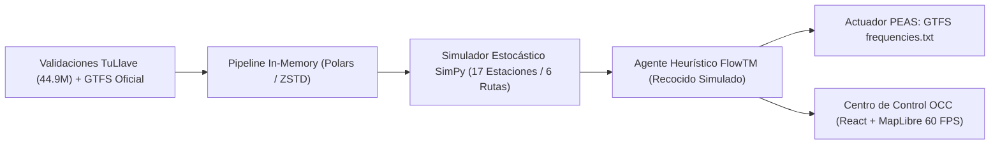

# FlowTM Wiki Oficial: Gemelo Digital y Centro de Control (OCC)

Bienvenido a la **Wiki Oficial de FlowTM** (*Flow TransMilenio*), un Gemelo Digital físico-estocástico por eventos discretos (DES) con inteligencia artificial y optimización heurística para el sistema de transporte masivo BRT de Bogotá D.C.

---

## 🧭 Mapa de Navegación de la Wiki

### Proyecto
* [**Información General y Modelado Físico**](Info-General): Los 8 modelos analíticos acoplados en SimPy (Poisson NHPP, colas $Q(t)$, TCQSM dwell time, cinemática Haversine, bunching y ley de flota).
* [**Arquitectura de Software y Patrones de Diseño**](Arquitectura): Clean Architecture Hexagonal, patrones GoF (Repository, Observer, Strategy, State), in-memory con Polars/Arrow y desacoplamiento frontend.
* [**Estructura del Repositorio**](Estructura-Repo): Árbol de directorios y organización del código fuente.

### Inteligencia Artificial & Simulación
* [**Agente Racional y Optimización Heurística**](Agente-IA-Optimizacion): Formulación PEAS (Avance II), función de utilidad $U(S)$, cota dura $\le 106$ buses, Recocido Simulado en $\mathbb{R}^6$ y matriz de cumplimiento de metas.
* [**Centro de Control de Operaciones (OCC)**](Centro-de-Control-OCC): Arquitectura React 19 + MapLibre GL a 60 FPS, tokens de diseño, modo Split-Screen sincronizado, inspector vehicular y analítica pedagógica en 4 fases.
* [**Guía de Ejecución y Reproducibilidad**](Simulador-Guia-Ejecucion): Manual paso a paso con `uv` y `bun`, pipelines de datos (`01`, `02`, `03`), exportador GTFS y suite de pruebas `pytest`.

### Desarrollo
* [**Empezar a Desarrollar**](Desarrollo-Empezando): Configuración del entorno de desarrollo local con `uv` y WSL.
* [**Flujo de Trabajo**](Desarrollo-Flujo-De-Trabajo): Guía de convenciones, ramas y buenas prácticas.
* [**Flujo de Trabajo Git**](Desarrollo-Git): Protocolo de ramas y commits.
* [**Pull Requests**](Desarrollo-Pull-Requests): Lineamientos de integración y revisión de código.

### Datos (Data Engineering)
* [**Resumen Data**](Data-Resumen): Ingesta, tipado y estandarización de 44.9M de validaciones *tullave* y datos GTFS.
* [**Data Pipeline**](Data-Pipeline): Pipeline ETL con Polars y Apache Arrow hacia Parquets ZSTD.
* [**Validación de Datos**](Data-Validacion): Auditoría de calidad de datos, nulos e inconsistencias temporales.

### DevOps & Despliegue
* [**Configuración**](DevOps-Configuracion): Parámetros y variables de entorno del sistema.
* [**Secrets**](DevOps-Secrets): Gestión de secretos y claves seguras.
* [**Despliegue**](DevOps-Despliegue): Estrategias de compilación y despliegue del simulador y frontend.

---

## 📌 Ficha Técnica del Gemelo Digital

* **Corredor Modelado:** Eje Troncal Autopista Norte — Avenida Caracas (Sentido Sur $
ightarrow$ Norte en franja pico matutina 06:00 a 09:00 AM).
* **Topología:** 17 estaciones consecutivas modeladas con precisión geodésica milimétrica, desde *Calle 45* (nodo sur) hasta *Portal del Norte* (cabecera norte).
* **Servicios Troncales (6 Rutas Oficiales):** `B13`, `B18`, `B23`, `B27`, `B74` y `B75`.
* **Demanda Empírica Calibrada:** 44.93 millones de registros del sistema *tullave* (validaciones de entrada y descensos en torniquete) procesados con Apache Arrow y Polars.
* **Restricción Física Presupuestal:** Cota dura de máximo **106 buses físicos** articulados simultáneos (**$0 USD en adquisición de flota / $0 CAPEX**).

---

## 🏆 Impacto Comprobado del Agente Racional

| Métrica Operacional | Escenario Base (GTFS Vigente) | Escenario Optimizado (FlowTM) | Impacto Obtenido |
| :--- | :---: | :---: | :---: |
| **Flota Física en Circulación** | 106 buses | **96 buses** | **-10 buses físicos liberados (-9.4%)** |
| **Tiempo Medio de Espera en Andén ($ar{W}$)** | 3.67 min (220.2 s) | **3.48 min (208.8 s)** | **-5.17% promedio global (hasta -22% en transbordos)** |
| **Factor de Ocupación Promedio** | 88.1% (hacinamiento) | **82.4% (rango óptimo)** | **Distribución homogénea y confortable** |
| **Regularidad de Salidas (CV Headways)** | 0.42 | **0.28** | **-33.3% mitigación de *bus bunching*** |
| **Ganancia Neta de Utilidad Multi-Criterio** | $U_0 = 0.6120$ | **$U^* = 0.6854$** | **$\Delta U = +0.0734$ (Mejora significativa)** |
| **Entregable Estándar Interoperable** | Horarios estáticos | `frequencies.txt` | **100% compatible con estándar GTFS MobilityData** |

> [!NOTE]
> **Aclaración de Ingeniería: Despachos Totales (347) vs. Flota Física (96 / 106):**
> La flota física corresponde a los vehículos tangibles en operación continua sobre el corredor. Dado que el tiempo de ciclo promedio de ida y vuelta es de ~40 minutos, cada bus físico rota aproximadamente 3.6 veces a lo largo de las 3 horas de simulación pico (180 min), generando un total acumulado de **347 despachos troncales**.

---

## 👥 Equipo de Investigación y Créditos

Proyecto desarrollado en el marco del programa de **Ingeniería de Sistemas y Computación (2026)**:

* **Ludwig Alvarado** — *Arquitectura de Software y Modelado Estocástico* ([@TheLudway](https://github.com/TheLudway))
* **Kevin Adrian Pinilla Naranjo** — *Ingeniería de Simulación, IA Heurística y Frontend OCC* ([@KevinAPN](https://github.com/KevinAPN))
* **Albert Geovanny Mahecha Reyes** — *Pipelines de Big Data y Calibración Empírica* ([@mahecha08](https://github.com/mahecha08))
* **Maria Fernanda Ospina Rocha** — *Formulación de Modelos y Análisis Operativo* ([@mf-ospina](https://github.com/mf-ospina))

### Licenciamiento
* **Código Fuente:** [GNU General Public License v3.0 or later (GPL-3.0-or-later)](https://www.gnu.org/licenses/gpl-3.0.html).
* **Documentación, Modelos y Diseños:** [Creative Commons Attribution 4.0 International (CC-BY-4.0)](https://creativecommons.org/licenses/by/4.0/).
