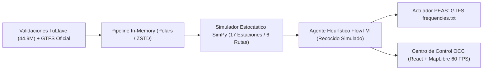

# Wiki Oficial de FlowTM: Gemelo Digital y Centro de Control Operativo (OCC)

Bienvenido a la **Wiki Oficial de FlowTM** (*Flow TransMilenio*), un Gemelo Digital físico-estocástico por eventos discretos (DES) con inteligencia artificial y optimización heurística para el sistema de transporte masivo BRT de Bogotá D.C.

---

## 🧭 Mapa de Navegación de la Wiki

Esta wiki está organizada en 5 volúmenes temáticos exhaustivos para consulta académica, técnica y operativa:

| Capítulo | Título del Documento | Enfoque Principal |
| :---: | :--- | :--- |
| **01** | [**Fundamentación Matemática y Modelado Físico**](01-Fundamentacion-Matematica-y-Modelado-Fisico) | Los 7 modelos analíticos y físicos acoplados en SimPy (Poisson NHPP, colas $Q(t)$, TCQSM dwell time, cinemática, bunching). |
| **02** | [**Arquitectura de Software y Patrones de Diseño**](02-Arquitectura-de-Software-y-Patrones) | Clean Architecture (Hexagonal), Repository Pattern, Observer, Strategy, State, y pipelines in-memory con Polars y Parquet. |
| **03** | [**Agente Racional IA y Optimización Heurística**](03-Agente-IA-y-Optimizacion-Heuristica) | Formulación PEAS (Avance II), función de utilidad $U(S)$, cota física $\le 106$ buses, Recocido Simulado en $\mathbb{R}^6$, y validador de metas. |
| **04** | [**Centro de Control de Operaciones (OCC) & Frontend Web**](04-Centro-de-Control-OCC-y-Frontend-Web) | Arquitectura React 19 + MapLibre GL, sistema de diseño (`taste-skill`, `impeccable`, `emil-kowalski`), modo pantalla dividida e inspector live. |
| **05** | [**Guía de Instalación, Pipelines y Reproducibilidad**](05-Guia-de-Instalacion-y-Reproducibilidad) | Manual paso a paso con `uv` y `bun`, ejecución de los scripts `01`, `02`, `03`, exportador GTFS y suite de pruebas `pytest`. |

---

## 📌 Ficha Técnica del Gemelo Digital

* **Corredor Modelado:** Eje Troncal Autopista Norte — Avenida Caracas (Sentido Sur $\rightarrow$ Norte en franja pico matutina 06:00 a 09:00 AM).
* **Topología:** 17 estaciones consecutivas modeladas con precisión milimétrica geodésica, desde *Calle 45* (nodo sur) hasta *Portal del Norte* (cabecera norte).
* **Servicios Troncales (6 Rutas Oficiales):** 
  * `B13` (Portal Tunal $\rightarrow$ Portal Norte)
  * `B18` (Portal 20 de Julio $\rightarrow$ Portal Norte / Terminal)
  * `B23` (Portal Eldorado $\rightarrow$ Portal Norte / Alcalá)
  * `B27` (Portal Tunal $\rightarrow$ Portal Norte expreso)
  * `B74` (Universidades $\rightarrow$ Portal Norte expreso)
  * `B75` (Portal Usme $\rightarrow$ Portal Norte alta frecuencia)
* **Demanda Empírica Calibrada:** 44.93 millones de registros del sistema *tullave* (validaciones de entrada y descensos en torniquete) procesados con Apache Arrow y Polars.
* **Restricción Física Presupuestal:** Cota dura de máximo **106 buses físicos** articulados y biarticulados simultáneos (**$0 USD en adquisición de flota / $0 CAPEX**).
* **Impacto Comprobado del Agente Racional:**
  * **Flota Consumida:** Reducción de 106 buses a **96 buses** (-10 móviles liberados para mantenimiento o reserva).
  * **Tiempo Medio de Espera en Andén:** Reducción de **3.67 min a 3.48 min** (-5.1% en promedio global; hasta -22% en estaciones de transbordo).
  * **Ganancia Neta de Utilidad Multi-Criterio:** $\Delta U = \mathbf{+0.0734}$ con convergencia monotónica estable.
  * **Entregable Estándar:** Exportación directa del archivo estandarizado `frequencies.txt` de la especificación internacional GTFS.

---

## 👥 Equipo de Investigación y Créditos

Proyecto desarrollado en el marco del programa de **Ingeniería de Sistemas y Computación**:

* **Ludwig Alvarado** — *Arquitectura de Software y Modelado Estocástico* ([@TheLudway](https://github.com/TheLudway))
* **Kevin Adrian Pinilla Naranjo** — *Ingeniería de Simulación, IA Heurística y Frontend OCC* ([@KevinAPN](https://github.com/KevinAPN))
* **Albert Geovanny Mahecha Reyes** — *Pipelines de Big Data y Calibración Empírica* ([@mahecha08](https://github.com/mahecha08))
* **Maria Fernanda Ospina Rocha** — *Formulación de Modelos y Análisis Operativo* ([@mf-ospina](https://github.com/mf-ospina))

### Licenciamiento
Este proyecto se distribuye bajo un esquema de licenciamiento abierto dual:
* **Código Fuente:** [GNU General Public License v3.0 or later (GPL-3.0-or-later)](https://www.gnu.org/licenses/gpl-3.0.html).
* **Documentación, Modelos y Diseños:** [Creative Commons Attribution 4.0 International (CC-BY-4.0)](https://creativecommons.org/licenses/by/4.0/).
